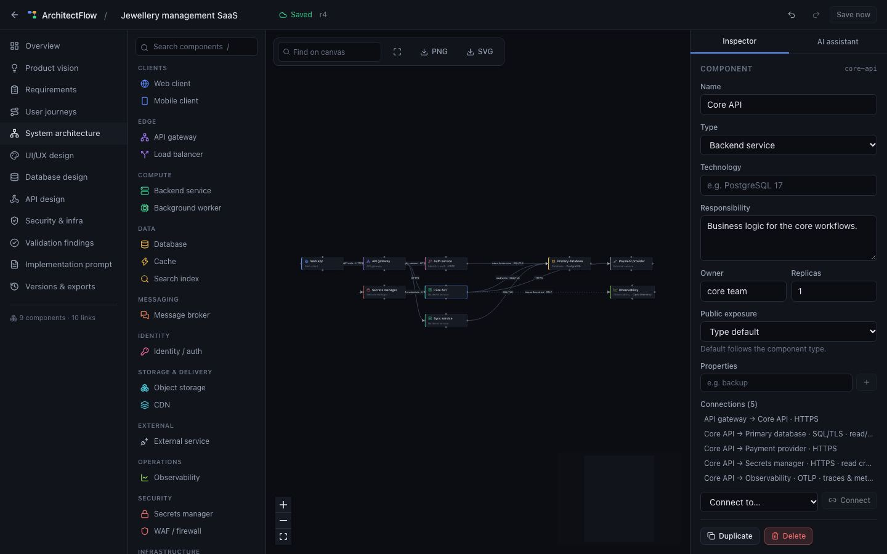
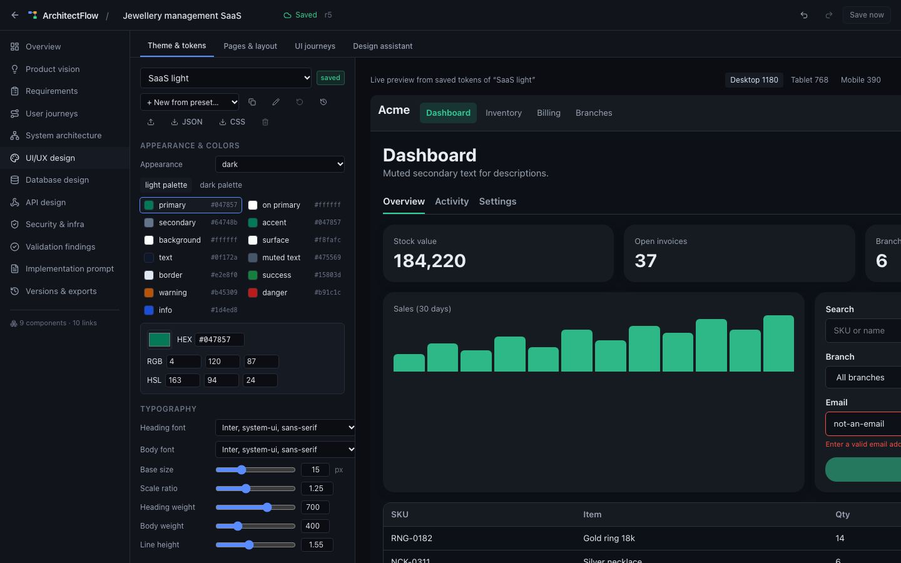
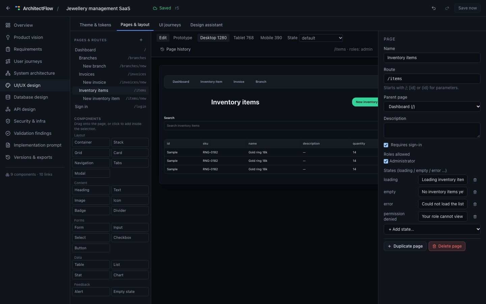
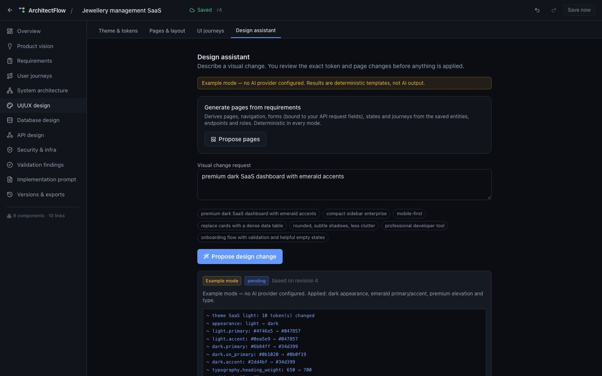
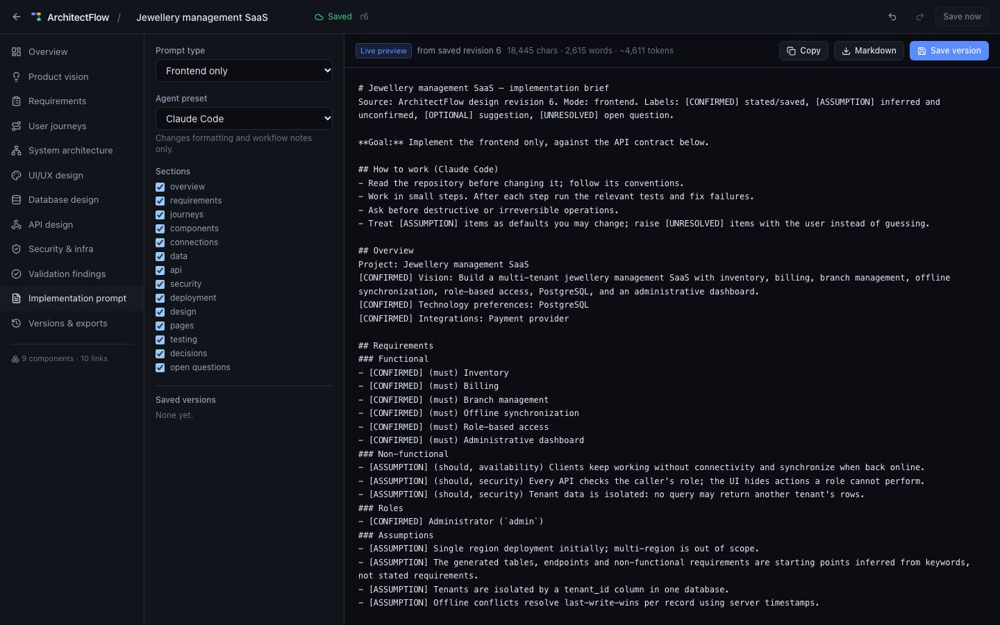
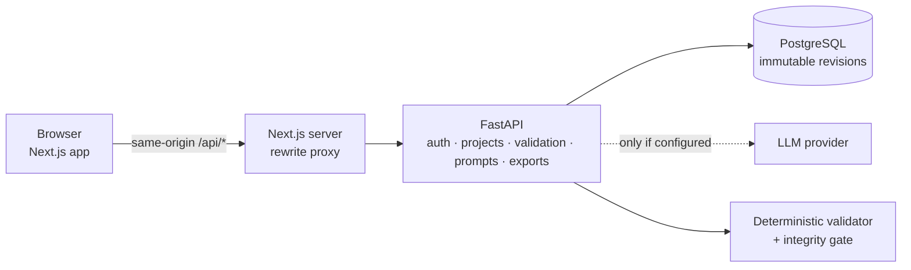

# ArchitectFlow


**Design a software system — architecture, data, API and UI — as structured, versioned data,
validate it with deterministic rules, and generate an implementation prompt from the exact saved
revision.**

> Status: **experimental 0.1.0 — not production-ready.** It runs fully offline in a clearly
> labeled *example mode* (deterministic templates, not AI). Real LLM providers are supported
> but have only been tested against local mock servers; see [Limitations](#limitations).



## Why

Diagrams drift from what gets built, AI assistants silently rewrite designs, and the prompt you
hand a coding agent is usually assembled from stale chat history. ArchitectFlow keeps one typed
document per project (requirements, components, connections, entities, endpoints, theme tokens,
pages) and makes every change explicit:

- **AI proposals are change sets.** They are validated, shown as a diff with validation findings,
  and applied only when you click *Apply* — a large replacement needs extra confirmation.
- **Validation is deterministic.** Findings quote the evidence from your saved design and say how
  to fix it. Definite schema errors are separated from recommendations; nothing is labeled a
  "confirmed vulnerability".
- **Prompts are derived artifacts.** Each one records the revision it came from and is marked
  *OUTDATED* when the design changes. Every line is labeled `[CONFIRMED]`, `[ASSUMPTION]`,
  `[OPTIONAL]` or `[UNRESOLVED]`.

**Who it's for:** engineers and tech leads planning a new system or a large feature who want a
reviewable design and a precise brief for a human team or a coding agent.

**Alternatives:** general diagram tools (draw.io, Excalidraw) are excellent for drawing but don't
validate semantics or generate specs; C4/Structurizr-style DSLs are rigorous but text-first;
AI chat produces fast drafts with no persistence or review. ArchitectFlow sits between them and is
much younger than any of them.

## Quick start

Prerequisites: [uv](https://docs.astral.sh/uv/), Node.js 20.9+ (24 recommended), PostgreSQL 15+
server binaries (`initdb`/`pg_ctl`, e.g. Homebrew `postgresql@17` or the Linux `postgresql`
package). No API key and no Docker needed.

```bash
git clone https://github.com/hellpuffyt/ArchitectFlow.git
cd ArchitectFlow
scripts/dev.sh
```

`scripts/dev.sh` creates a throwaway PostgreSQL cluster in `.dev/` (TCP `127.0.0.1:54329`),
installs dependencies, runs migrations and starts the API (`:8000`, docs at `/api/docs`) and the
web app at <http://localhost:3000>. Then:

1. Create an account and click **Sample project**.
2. In **Product vision**, click **Generate architecture**, review the proposed changes, **Apply**.
3. Edit the graph, open **Validation findings**, then **Implementation prompt** → **Copy**.

## Walkthrough: the jewellery SaaS example

Vision used throughout the docs and the end-to-end tests:

> Build a multi-tenant jewellery management SaaS with inventory, billing, branch management,
> offline synchronization, role-based access, PostgreSQL, and an administrative dashboard.

Example mode turns it into 9 components, 10 connections, 4 tables (with `tenant_id` foreign keys
and indexes) and 10 endpoints; stated features become confirmed requirements, inferred
non-functional requirements and the data model become **assumptions** you confirm. "Propose pages"
derives 8 pages, forms bound to the endpoints' request fields, and 3 journeys. The resulting design
is in [examples/jewellery-saas.architecture.json](examples/jewellery-saas.architecture.json).

Validation of that file (real output):

```text
warning ui-field-without-destination   page Sign in (/login): input 'Password' in form page-login-form
warning ui-field-without-destination   page Sign in (/login): input 'Email' in form page-login-form
info    missing-accessibility-requirement 8 page(s), no accessibility requirement
```

(The generated sign-in form really has no API endpoint — the design has an auth service but no
login endpoint yet.) Start of the generated *Backend & API* prompt:

```text
# Jewellery management SaaS — implementation brief
Source: ArchitectFlow design revision 4. Mode: backend_api. Labels: [CONFIRMED] stated/saved, [ASSUMPTION] inferred and unconfirmed, [OPTIONAL] suggestion, [UNRESOLVED] open question.
...
### Non-functional
- [ASSUMPTION] (should, security) Tenant data is isolated: no query may return another tenant's rows.
```

| Theme editor with live preview | Page designer |
|---|---|
|  |  |
| **AI design proposal under review** | **Prompt from the saved revision** |
|  |  |

## Features

**Implemented**
- Accounts (argon2id, httpOnly cookie sessions, CSRF header), private projects, search, rename,
  duplicate, archive, delete; immutable revisions with restore; conflict detection (409) between tabs.
- Twelve workspaces sharing one versioned document: Overview, Product vision, Requirements
  (confirm assumptions, roles, constraints, acceptance criteria, open questions), User journeys,
  System architecture, UI/UX design, Database design (entities, FKs, indexes, ER diagram),
  API design (methods, paths, request/response fields mapped to columns, auth, errors,
  pagination), Security & infra, Validation findings, Implementation prompt, Versions & exports.
- Graph editor (React Flow): 18 component types, palette search and drag-and-drop, inspector,
  connections with protocol/direction/sync/encryption, multi-select, grouping, duplicate, delete
  confirmation that lists detached entities/endpoints, find, minimap, fit view, PNG/SVG export,
  keyboard shortcuts, undo/redo, autosave with visible status.
- UI/UX Design Studio: theme tokens (palettes for light/dark, HEX/RGB/HSL, typography, spacing,
  radii, elevation, component styles, layout and breakpoints, motion) driving a live interactive
  preview; WCAG contrast computed from the tokens; presets; theme import/export/restore.
  Page designer with typed layout trees, drag-and-drop, breakpoint previews that apply the theme's
  breakpoint rules, page-state previews, prototype mode that distinguishes implemented from
  visual-only interactions, UI→API/entity bindings, UI journeys.
- Deterministic validation (94 rule ids: structural integrity checks plus recommendations): broken references, client→datastore, public internal
  components, missing auth, plaintext/unencrypted boundaries, secrets, synchronous cycles, shared
  databases, SPOF under availability requirements, unbounded queues/retries, monitoring/backup,
  constraint contradictions, UI references to missing APIs/entities/pages, unmapped form fields,
  missing states/responsive rules, color contrast, conflicting and duplicate requirements.
- AI providers: labeled example mode (default), OpenAI-compatible Chat Completions, Anthropic
  Messages. Missing key → 503, unreachable → 502, timeout → 504, provider rate limit → 429,
  invalid output → 422; the design is never changed on failure.
- Prompt generator: 8 modes (complete app, frontend, design system, single page, backend & API,
  database, architecture docs, testing & QA) × 3 agent presets, section selection, live preview,
  versions with OUTDATED marking, copy, Markdown download.
- Exports: JSON and project bundle (re-importable), Mermaid flowchart, PlantUML, C4 context and
  container, sequence (from journeys), ERD, data-flow, service dependencies, deployment,
  PostgreSQL DDL, OpenAPI 3.1, technical spec, design tokens JSON + CSS variables, design spec,
  page flow, route map, component inventory.
- Read-only share links (hashed 256-bit tokens, expiry, revocation), account data export and
  deletion, audit events.

**Experimental:** real LLM providers (request/response handling tested against local mock HTTP
servers only); Docker images and Compose file (built and run end-to-end on arm64 only).

**Planned:** team collaboration and roles per project, real-time co-editing, OIDC sign-in, a
background job queue for exports, multi-process rate limiting (see [roadmap](#roadmap)).

## Architecture



Every change — manual save, import, AI change set, restore — goes through the same integrity gate
and becomes a new immutable revision. Details: [docs/ARCHITECTURE.md](docs/ARCHITECTURE.md).

## Configuration

All settings are environment variables prefixed `ARCHITECTFLOW_`; see
[.env.example](.env.example) and [docs/CONFIGURATION.md](docs/CONFIGURATION.md). The defaults run
locally with no secrets. To use a real model:

```bash
export ARCHITECTFLOW_AI_PROVIDER=anthropic   # or openai (any OpenAI-compatible server)
export ARCHITECTFLOW_AI_API_KEY=...          # server-side only, never sent to the browser
export ARCHITECTFLOW_AI_MODEL=...            # required for openai; anthropic defaults to claude-sonnet-5
```

The UI tells users when designs are sent to an external provider.

## Testing

```bash
scripts/dev-db.sh start
(cd apps/api && uv run pytest)                       # 172 tests, real PostgreSQL
(cd apps/web && npm test)                             # 48 Vitest tests
(cd apps/web && npx playwright test)                  # 20 browser specs + 2 opt-in, real API + PostgreSQL
ARCHITECTFLOW_E2E_STOP_DB=1 npx playwright test -g "PostgreSQL down"   # stops/starts the local cluster
bash scripts/test-dev-db.sh                           # dev cluster from a deep checkout path
```

Evidence, exact commands and results per acceptance item: [docs/PRODUCTION_READINESS.md](docs/PRODUCTION_READINESS.md).

## Security model

Owner-only access enforced on every route (other users get 404), CSRF header on writes,
argon2id, hashed session and share tokens, server-side AI keys, untrusted-output validation,
escaped exports, rate limits on login/AI/exports. Read [docs/SECURITY_MODEL.md](docs/SECURITY_MODEL.md)
and report vulnerabilities privately per [SECURITY.md](SECURITY.md).

## Deployment

The API needs a long-running Python process and PostgreSQL, so a static/serverless host alone
(e.g. Vercel) cannot run the whole app. Options and their verification status are in
[docs/DEPLOYMENT.md](docs/DEPLOYMENT.md).

## Troubleshooting

| Symptom | Fix |
|---|---|
| `PostgreSQL server binaries not found` | Install PostgreSQL 15+ or set `PG_BIN` to its `bin` directory. |
| `PostgreSQL failed to start … Last log lines` | Read the printed log; usually port 54329 is taken — set `ARCHITECTFLOW_PG_PORT`. |
| `EADDRINUSE` on `:3000` or `:8000` from `scripts/dev.sh` | Another process holds the port — set `ARCHITECTFLOW_WEB_PORT` / `ARCHITECTFLOW_API_PORT`. |
| Sign-in works but every write says *CSRF token* | Reload the page (the token is per session). |
| Login cookie not kept on `http://localhost` | Set `ARCHITECTFLOW_SECURE_COOKIES=false` for local plain HTTP (`scripts/dev.sh` does). |
| "AI provider … configured but ARCHITECTFLOW_AI_API_KEY is not set" | Set the key or use `ARCHITECTFLOW_AI_PROVIDER=example`. |
| Status shows *Conflict* | Another tab saved a newer revision: load it, or save yours as the newest. |
| Web app calls the wrong API | `ARCHITECTFLOW_API_ORIGIN` is read at **build** time; rebuild. |

## Limitations

See [docs/LIMITATIONS.md](docs/LIMITATIONS.md). Highlights: single-owner projects (no team
editing yet); rate limits are per API process; the canvas editor is designed for screens ≥ 1024 px;
real LLM output quality is not evaluated; diagrams are export-only (no re-import).

## Roadmap

1. Project members with viewer/editor roles. 2. OIDC sign-in. 3. Evaluated prompts for real
providers. 4. Re-import of Mermaid/C4 where lossless. 5. Shared rate-limit store.
Starter tasks: [docs/good-first-issues.md](docs/good-first-issues.md).

## Contributing & license

See [CONTRIBUTING.md](CONTRIBUTING.md) and [CODE_OF_CONDUCT.md](CODE_OF_CONDUCT.md).
Dual-licensed under [MIT](LICENSE-MIT) or [Apache-2.0](LICENSE-APACHE), at your option.
