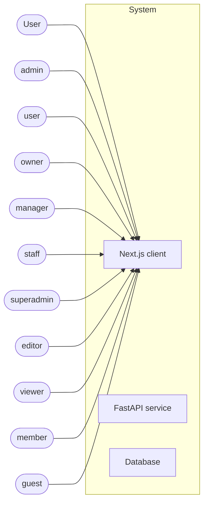
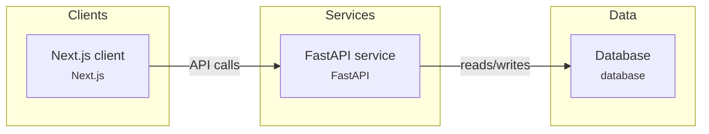
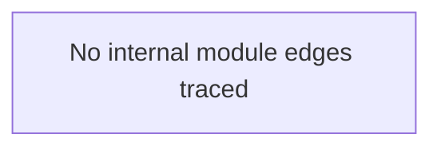
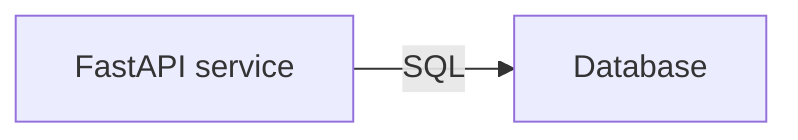
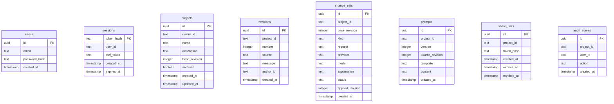
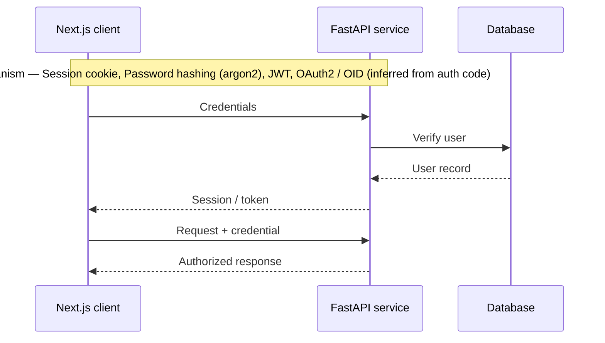
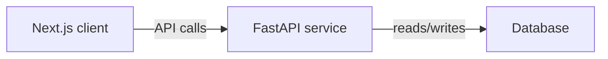
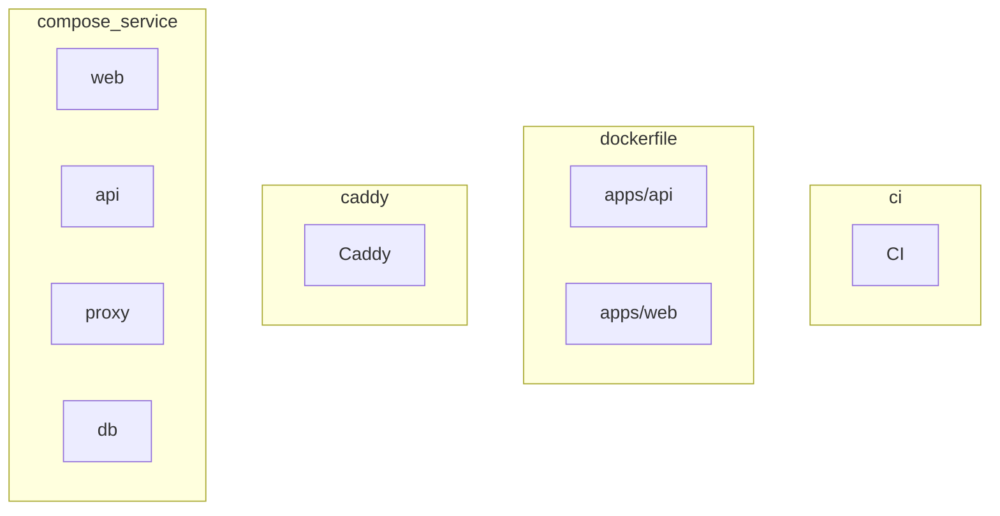

# System Architecture — ArchitectFlow

> Generated by **ArchitectFlow** from source on 2026-11-01T07:22:22.831Z. Every claim is traceable to the code cited beside it. Confidence: ✅ verified (direct evidence) · 🟡 inferred · 💡 recommendation · ❔ unknown/externally configured.

**Scope analysed:** 247 files · TypeScript (104), Python (68), JavaScript (1) · 1 skipped (sensitive/vendored/too large).

## A. System overview

- **Purpose:** Source-grounded system design for "ArchitectFlow", reverse-engineered from the repository by ArchitectFlow. Languages: TypeScript, Python, JavaScript. This is observed implementation, not a product vision.
- **Architectural style:** Monorepo with separate frontend and backend services
- **Technology stack:** Next.js, React, FastAPI, SQLAlchemy, Alembic, Pydantic, TypeScript, Python, JavaScript
- **Package managers / build:** npm, uv, Docker, Docker Compose, Next.js
- **Workspaces:** monorepo, 3 — `apps/api` (architectflow-api), `apps/cli` (architectflow), `apps/web` (architectflow-web)

### Frameworks (declared)
- **Next.js** — `apps/web/package.json:18` (next)
- **React** — `apps/web/package.json:19` (react)
- **FastAPI** — `apps/api/pyproject.toml:8` (fastapi)
- **SQLAlchemy** — `apps/api/pyproject.toml:10` (sqlalchemy)
- **Alembic** — `apps/api/pyproject.toml:11` (alembic)
- **Pydantic** — `apps/api/pyproject.toml:13` (pydantic)

### System context

## B. Architecture

### Container view (C4 level 2)

### Components / modules (from traced imports)

### Service dependencies

### Components table

| Component | Type | Technology | Confidence | Source |
|---|---|---|---|---|
| Next.js client | `web_client` | Next.js | ✅ verified | `apps/web/app/layout.tsx` |
| FastAPI service | `service` | FastAPI | ✅ verified | `apps/api/architectflow/main.py:18` (FastAPI()) |
| Database | `database` |  | 🟡 inferred | `apps/api/architectflow/models.py:33` (class User) |

## C. Data architecture

- **Entities:** 8 · **Migrations:** alembic (1)

### Entity–relationship

#### `users` — `apps/api/architectflow/models.py:33` (class User)

| Field | Type | PK | Null | Unique | FK |
|---|---|---|---|---|---|
| id | uuid | • | • |  |  |
| email | text |  | • | • |  |
| password_hash | text |  | • |  |  |
| created_at | timestamp |  | • |  |  |

#### `sessions` — `apps/api/architectflow/models.py:41` (class AuthSession)

| Field | Type | PK | Null | Unique | FK |
|---|---|---|---|---|---|
| token_hash | text | • | • |  |  |
| user_id | text |  | • |  |  |
| csrf_token | text |  | • |  |  |
| created_at | timestamp |  | • |  |  |
| expires_at | timestamp |  | • |  |  |

#### `projects` — `apps/api/architectflow/models.py:53` (class Project)

| Field | Type | PK | Null | Unique | FK |
|---|---|---|---|---|---|
| id | uuid | • | • |  |  |
| owner_id | text |  | • |  |  |
| name | text |  | • |  |  |
| description | text |  | • |  |  |
| head_revision | integer |  | • |  |  |
| archived | boolean |  | • |  |  |
| created_at | timestamp |  | • |  |  |
| updated_at | timestamp |  | • |  |  |

#### `revisions` — `apps/api/architectflow/models.py:67` (class Revision)

| Field | Type | PK | Null | Unique | FK |
|---|---|---|---|---|---|
| id | uuid | • | • |  |  |
| project_id | text |  | • |  |  |
| number | integer |  | • |  |  |
| source | text |  | • |  |  |
| message | text |  | • |  |  |
| author_id | text |  | • |  |  |
| created_at | timestamp |  | • |  |  |

#### `change_sets` — `apps/api/architectflow/models.py:84` (class ChangeSet)

| Field | Type | PK | Null | Unique | FK |
|---|---|---|---|---|---|
| id | uuid | • | • |  |  |
| project_id | text |  | • |  |  |
| base_revision | integer |  | • |  |  |
| kind | text |  | • |  |  |
| request | text |  | • |  |  |
| provider | text |  | • |  |  |
| mode | text |  | • |  |  |
| explanation | text |  | • |  |  |
| status | text |  | • |  |  |
| applied_revision | integer |  | • |  |  |
| created_at | timestamp |  | • |  |  |

#### `prompts` — `apps/api/architectflow/models.py:105` (class GeneratedPrompt)

| Field | Type | PK | Null | Unique | FK |
|---|---|---|---|---|---|
| id | uuid | • | • |  |  |
| project_id | text |  | • |  |  |
| version | integer |  | • |  |  |
| source_revision | integer |  | • |  |  |
| template | text |  | • |  |  |
| content | text |  | • |  |  |
| created_at | timestamp |  | • |  |  |

#### `share_links` — `apps/api/architectflow/models.py:119` (class ShareLink)

| Field | Type | PK | Null | Unique | FK |
|---|---|---|---|---|---|
| id | uuid | • | • |  |  |
| project_id | text |  | • |  |  |
| token_hash | text |  | • | • |  |
| created_at | timestamp |  | • |  |  |
| expires_at | timestamp |  | • |  |  |
| revoked_at | timestamp |  | • |  |  |

#### `audit_events` — `apps/api/architectflow/models.py:131` (class AuditEvent)

| Field | Type | PK | Null | Unique | FK |
|---|---|---|---|---|---|
| id | uuid | • | • |  |  |
| project_id | text |  | • |  |  |
| user_id | text |  | • |  |  |
| action | text |  | • |  |  |
| created_at | timestamp |  | • |  |  |

## D. Application flows

### Authentication (inferred)

### Data flow

### API surface

| Method | Path | Auth | Framework | Source |
|---|---|---|---|---|
| GET | `/api/health` | authenticated | FastAPI | `apps/api/architectflow/main.py:84` (@app.get) |
| GET | `/export` | authenticated | FastAPI | `apps/api/architectflow/routes/account.py:22` (@router.get) |
| POST | `/ai/generate` | authenticated | FastAPI | `apps/api/architectflow/routes/ai.py:202` (@router.post) |
| POST | `/ai/edit` | authenticated | FastAPI | `apps/api/architectflow/routes/ai.py:209` (@router.post) |
| POST | `/ai/design` | authenticated | FastAPI | `apps/api/architectflow/routes/ai.py:225` (@router.post) |
| POST | `/ai/pages` | authenticated | FastAPI | `apps/api/architectflow/routes/ai.py:232` (@router.post) |
| GET | `/changesets` | authenticated | FastAPI | `apps/api/architectflow/routes/ai.py:241` (@router.get) |
| GET | `/changesets/{cs_id}` | authenticated | FastAPI | `apps/api/architectflow/routes/ai.py:252` (@router.get) |
| POST | `/changesets/{cs_id}/apply` | authenticated | FastAPI | `apps/api/architectflow/routes/ai.py:257` (@router.post) |
| POST | `/changesets/{cs_id}/reject` | authenticated | FastAPI | `apps/api/architectflow/routes/ai.py:312` (@router.post) |
| POST | `/signup` | authenticated | FastAPI | `apps/api/architectflow/routes/auth.py:83` (@router.post) |
| POST | `/login` | authenticated | FastAPI | `apps/api/architectflow/routes/auth.py:105` (@router.post) |
| POST | `/logout` | authenticated | FastAPI | `apps/api/architectflow/routes/auth.py:130` (@router.post) |
| GET | `/me` | authenticated | FastAPI | `apps/api/architectflow/routes/auth.py:137` (@router.get) |
| GET | `/presets` | authenticated | FastAPI | `apps/api/architectflow/routes/design.py:15` (@router.get) |
| GET | `/{fmt}` | authenticated | FastAPI | `apps/api/architectflow/routes/exports.py:29` (@router.get) |
| GET | `/{project_id}` | authenticated | FastAPI | `apps/api/architectflow/routes/projects.py:109` (@router.get) |
| PATCH | `/{project_id}` | authenticated | FastAPI | `apps/api/architectflow/routes/projects.py:115` (@router.patch) |
| POST | `/{project_id}/duplicate` | authenticated | FastAPI | `apps/api/architectflow/routes/projects.py:138` (@router.post) |
| DELETE | `/{project_id}` | authenticated | FastAPI | `apps/api/architectflow/routes/projects.py:168` (@router.delete) |
| PUT | `/{project_id}/document` | authenticated | FastAPI | `apps/api/architectflow/routes/projects.py:182` (@router.put) |
| POST | `/{project_id}/validate-document` | authenticated | FastAPI | `apps/api/architectflow/routes/projects.py:210` (@router.post) |
| GET | `/{project_id}/revisions` | authenticated | FastAPI | `apps/api/architectflow/routes/projects.py:222` (@router.get) |
| GET | `/{project_id}/revisions/{number}` | authenticated | FastAPI | `apps/api/architectflow/routes/projects.py:235` (@router.get) |
| POST | `/{project_id}/revisions/{number}/restore` | authenticated | FastAPI | `apps/api/architectflow/routes/projects.py:240` (@router.post) |
| GET | `/{project_id}/findings` | authenticated | FastAPI | `apps/api/architectflow/routes/projects.py:269` (@router.get) |
| GET | `/{project_id}/audit` | authenticated | FastAPI | `apps/api/architectflow/routes/projects.py:284` (@router.get) |
| POST | `/preview` | authenticated | FastAPI | `apps/api/architectflow/routes/prompts.py:83` (@router.post) |
| POST | `/api/projects/{project_id}/shares` | authenticated | FastAPI | `apps/api/architectflow/routes/share.py:37` (@router.post) |
| GET | `/api/projects/{project_id}/shares` | authenticated | FastAPI | `apps/api/architectflow/routes/share.py:60` (@router.get) |
| DELETE | `/api/projects/{project_id}/shares/{share_id}` | authenticated | FastAPI | `apps/api/architectflow/routes/share.py:70` (@router.delete) |
| GET | `/api/shared/{token}` | authenticated | FastAPI | `apps/api/architectflow/routes/share.py:89` (@router.get) |
| GET | `/path` | authenticated | Express | `apps/cli/src/engine/symbols.ts:139` (.get()) |
| POST | `/path` | authenticated | Express | `apps/cli/src/engine/symbols.ts:139` (.post()) |
| GET | `/items` | authenticated | Express | `apps/cli/test/helpers.ts:26` (.get()) |
| POST | `/items` | authenticated | Express | `apps/cli/test/helpers.ts:26` (.post()) |

## E. Infrastructure

### Deployment

| Kind | Name | Source |
|---|---|---|
| ci | CI | `.github/workflows/ci.yml` |
| dockerfile | apps/api — base python:3.12-slim | `apps/api/Dockerfile` |
| dockerfile | apps/web — base node:24-trixie-slim | `apps/web/Dockerfile` |
| caddy | Caddy | `deploy/caddy/Caddyfile` |
| compose_service | web | `docker-compose.tls.yml` |
| compose_service | api | `docker-compose.tls.yml` |
| compose_service | proxy | `docker-compose.tls.yml` |
| compose_service | db | `docker-compose.yml` |

## F. Security architecture

**Observed (facts):**
- Session cookie — `apps/api/architectflow/ai/example.py:330` · roles: admin, user, owner, manager, staff, superadmin, editor, viewer, member, guest
- Password hashing (argon2) — `apps/api/architectflow/security.py:11`
- JWT — `apps/cli/src/engine/auth.ts:11`
- OAuth2 / OIDC — `apps/cli/src/engine/auth.ts:12`
- Password hashing (bcrypt) — `apps/cli/src/engine/auth.ts:14`
- Secret handling: 1 sensitive file(s) present and intentionally **not read** by the analyzer.

**Recommendations (not implementation facts):**
- Confirm every state-changing endpoint enforces authN/authZ; the extractor marks auth by heuristic and may miss middleware-level enforcement.
- Verify secrets are injected from the environment / a secrets manager, never committed (sensitive files were not inspected).

## G. Architecture assessment

_These are inferences and recommendations, separated from the observed facts above._

- **Single points of failure (candidate):** Database — confirm replication/backup.
- **Scalability:** no async worker tier detected; no cache tier detected.
- **Maintainability:** monorepo with 3 workspaces; 280 internal import edges traced.
- **Observability:** no observability stack detected in dependencies.

---
_ArchitectFlow local analysis. 59 elements, each with source evidence. No source was uploaded; no scripts were executed._