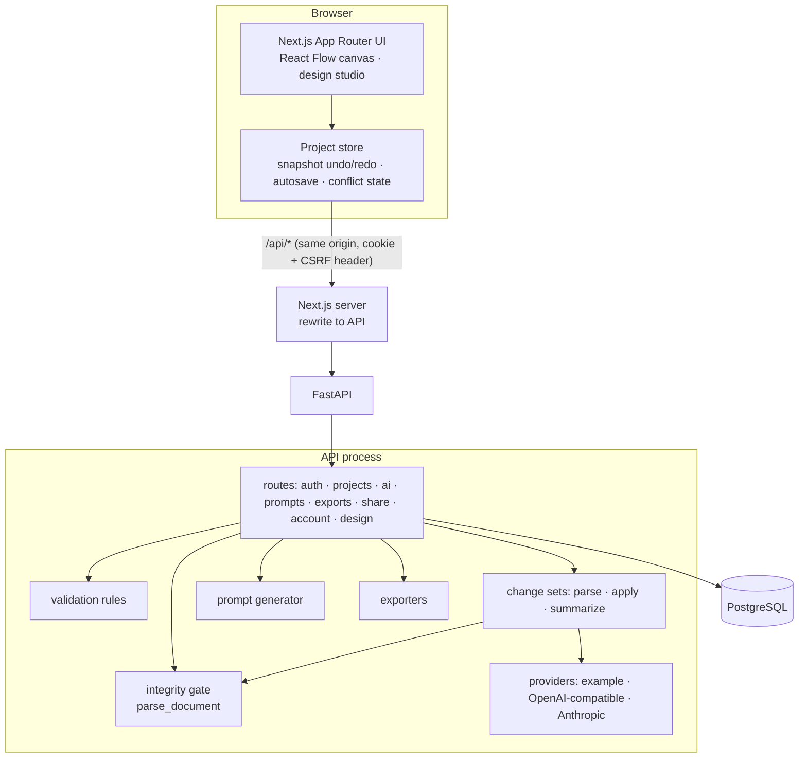

# Architecture



## One document, many workspaces

A project is a sequence of **immutable revisions**; each revision stores one JSON document
validated by the pydantic models in `apps/api/architectflow/schema/`:

| Section | Contents |
|---|---|
| `vision`, `requirements`, `actors`, `constraints`, `assumptions`, `open_questions`, `decisions` | Product intent. Requirements carry `status: confirmed | assumption`. |
| `nodes`, `edges`, `groups`, `workflows`, `viewport` | The architecture graph and system journeys. |
| `database.entities` | Tables, typed columns, PK/FK, indexes, the data store that holds them. |
| `api.endpoints` | Method, path, implementing service, auth/roles, request/response fields mapped to columns, errors, pagination. |
| `design` | Themes (tokens), pages (typed layout trees, responsive rules, interactions, states), UI journeys. |
| `prompt_settings` | The prompt mode, agent preset and sections the user last chose. |

Keeping everything in one document means undo/redo, autosave, version history, restore, export
and prompt staleness work identically for architecture and UI design. **Decision:** we chose one
document over linked per-workspace revisions because cross-references (UI → endpoint → entity →
data store) must be validated together; the trade-off is that every save writes the whole
document (bounded by `ARCHITECTFLOW_MAX_REQUEST_BYTES`, default 2 MB).

## Integrity vs recommendations

- **Integrity gate** (`validation/integrity.py`): definite structural defects — duplicate ids,
  dangling edges, unknown node types, FKs to missing columns, endpoints implemented by missing
  services, layout nesting, page hierarchy cycles. A document that fails is **never stored**;
  the API returns 422 with `{path, message}` errors.
- **Recommendations** (`validation/rules.py`, `ui_rules.py`): judgement calls with severity,
  evidence and remediation. Links from UI to APIs/entities/pages are *soft*: they may dangle
  after an architecture change and are reported, so neither side silently deletes the other.

## Change flow

```text
manual edit ─┐
import ──────┼─► parse_document (schema + integrity) ─► new revision (base_revision check, 409 on conflict)
restore ─────┘
AI request ─► provider JSON ─► parse_operations ─► apply to copy ─► parse_document ─► stored ChangeSet
             (untrusted)                                                            │ (user reviews diff + findings)
                                                                                   apply ─► new revision
```

Large destructive change sets (≥3 components and ≥40 % removed) require explicit confirmation.
Removing a component **detaches** entities and endpoints that referenced it instead of deleting them.

## Frontend

- `lib/project-store.tsx`: document history (snapshot undo/redo, drag gestures coalesced),
  debounced autosave with `base_revision`, explicit `saving / dirty / conflict / invalid /
  offline` states, and `serverOp` so the UI never shows *Saved* while a server mutation is pending.
- `components/canvas`: React Flow canvas (controlled from the document), palette, inspector.
- `components/design`: token-driven UI kit, theme editor, page renderer (applies breakpoint rules
  from the active theme), page designer.
- The browser only talks to the Next.js origin; `/api/*` is rewritten to FastAPI, so the session
  cookie stays same-origin and `httpOnly`.

## Repository layout

```text
apps/api      FastAPI service, Alembic migrations, pytest suite
apps/web      Next.js app, Vitest tests, Playwright E2E
scripts       dev.sh, dev-db.sh (throwaway PostgreSQL), e2e-api.sh, test-dev-db.sh
examples      the jewellery SaaS walkthrough design
docs          this documentation
```
